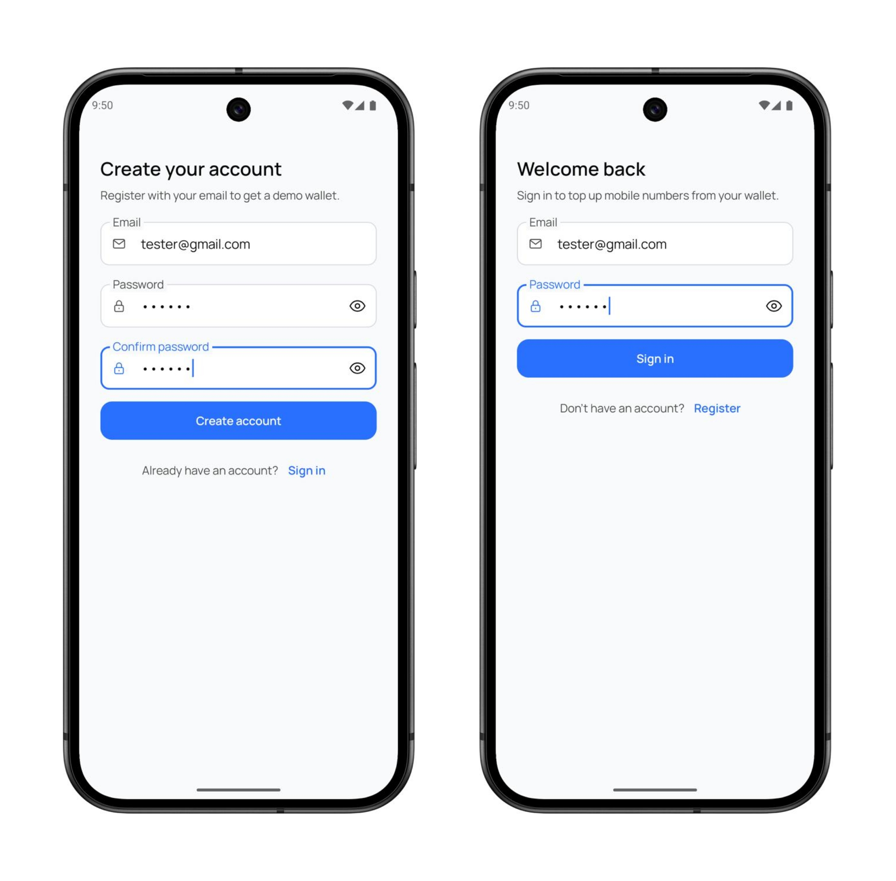
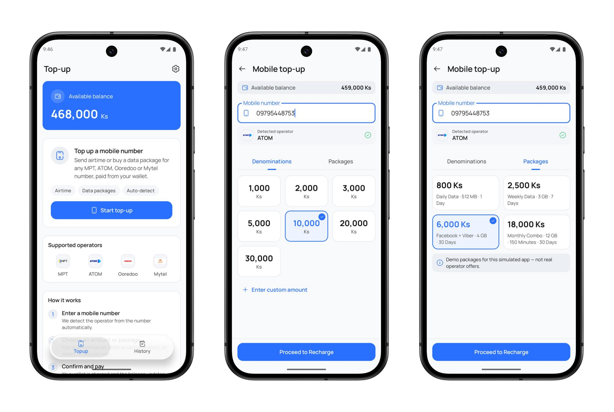
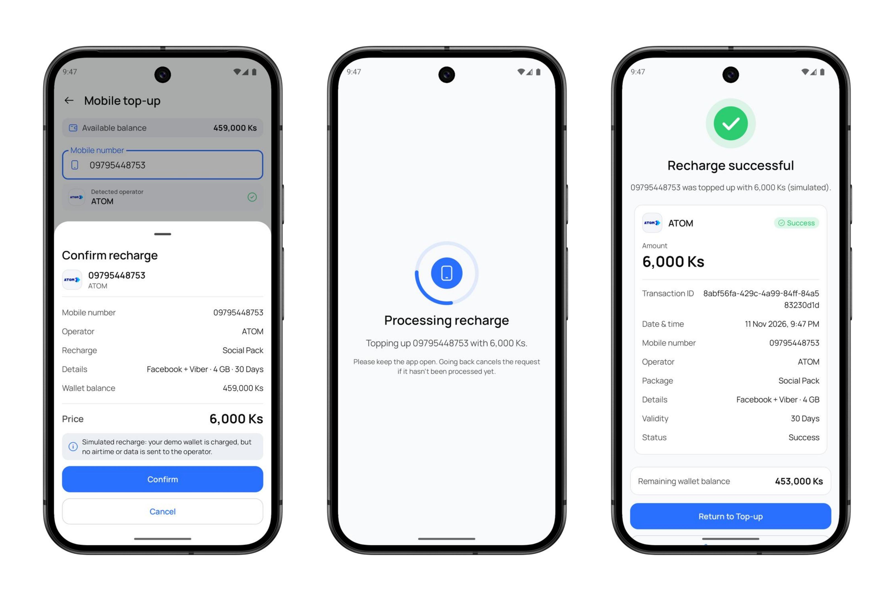
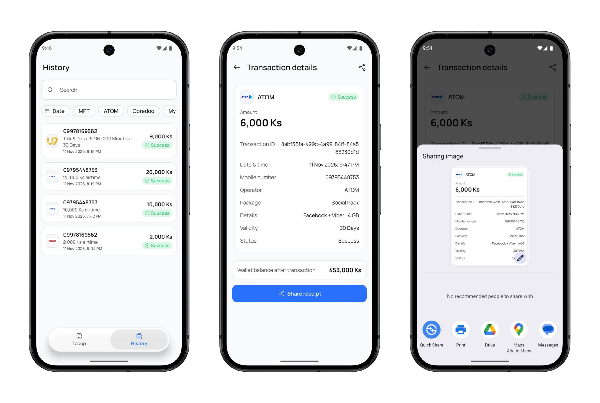
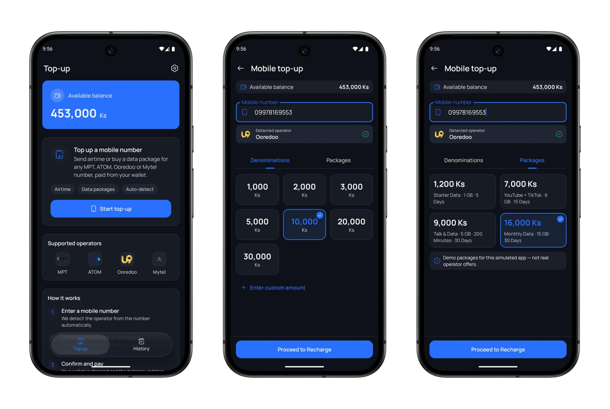
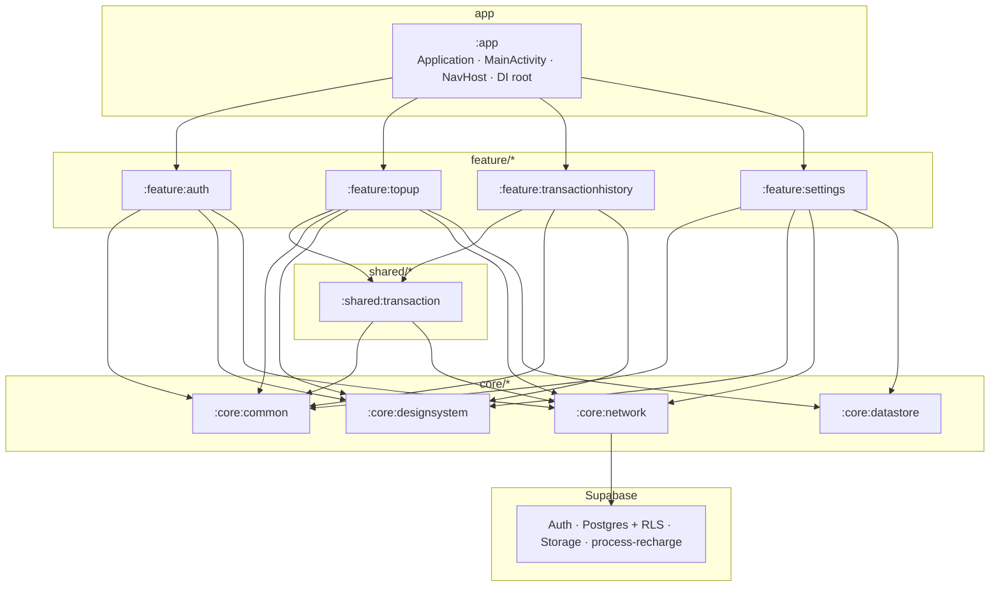

# TopUp

Native Android mobile top-up app for Myanmar telecom operators — email/password auth, offline operator detection, wallet-backed simulated recharges, and searchable transaction history.

[](https://kotlinlang.org/)
[](https://developer.android.com/jetpack/compose)
[](#architecture)
[](https://supabase.com/)
[](#project-information)

TopUp is a **coding-test demonstration** of production-minded Android engineering: typed multi-module navigation, Clean Architecture layers, offline-first catalog caching, and a Supabase backend with Row Level Security. Recharges update a **demo wallet** via an Edge Function — no real telecom or payment gateway is contacted.

---

## Overview

TopUp lets a signed-in user enter a Myanmar mobile number (`09` + 9 digits), automatically detect MPT, ATOM, Ooredoo, or Mytel from a local prefix table, browse that operator’s denominations and demo data packages, and complete a simulated recharge against their own wallet balance.

Successful recharges are stored per user and appear in History with search, operator/date filters, sorting, detail views, and receipt sharing. The product scope is intentionally focused so reviewers can evaluate architecture, UX polish, and end-to-end data flow without production telecom integration.

| | |
|---|---|
| **Platform** | Native Android only (Compose + Material 3) |
| **Package** | `com.aungthiha.topup` |
| **Min / Target SDK** | 24 / 37 |
| **Backend** | Supabase Auth, Postgres + RLS, Storage, Edge Functions |

---

## Features

| Area | Capability |
|---|---|
| **Authentication** | Email/password register and sign-in via Supabase Auth; session persistence across restarts; logout clears user-scoped local cache |
| **Operator detection** | Offline prefix matching (longest match wins); normalizes spaces, dashes, `+959…`, and Myanmar digits |
| **Catalog** | Denominations and data packages per operator; Room as UI source of truth; unified remote refresh once per cold launch |
| **Wallet** | Per-user demo balance (DataStore cache + Supabase `wallets` under RLS); shown immediately, refreshed when Top-up is visible |
| **Recharge** | Confirmation sheet → processing screen → idempotent `process-recharge` Edge Function → success receipt |
| **History** | User-scoped list with search, operator chips, date filter, sort, pagination (Load More), and transaction detail |
| **Receipt sharing** | Captures the receipt card to PNG and shares via Android Sharesheet (FileProvider) |
| **Appearance** | System / Light / Dark modes from Settings |
| **Adaptive UI** | Floating bottom bar on phones; navigation rail on medium+ width; portrait and landscape with retained screen state |
| **Observability** | Firebase Analytics and Crashlytics on `:app` |

> Recharge is **simulated**. The demo wallet is charged, but no airtime or data is sent to a telecom operator.

---

## Application Screenshots

### Authentication Flow

Register and sign-in with outlined Material 3 fields, password visibility toggles, and cross-links between the two screens.

<p align="center">
  
</p>

*Left: Create account · Right: Welcome back / Sign in*

### Top-up Flow

Wallet overview, supported operators, then mobile number entry with auto-detected operator, denomination grid, and data package selection.

<p align="center">
  
</p>

*Left: Top-up home · Center: Denominations · Right: Data packages*

### Recharge Flow — Loading and Success

Confirm details in a bottom sheet, keep the app open while the Edge Function runs, then land on a success receipt with remaining wallet balance.

<p align="center">
  
</p>

*Left: Confirm recharge · Center: Processing · Right: Recharge successful*

### Transaction History

Searchable, filterable history; transaction detail with share; system Sharesheet for the captured receipt image.

<p align="center">
  
</p>

*Left: History list · Center: Transaction details · Right: Share receipt*

### Dark Mode Support

The same top-up experience under the dark theme — primary actions, cards, and operator detection stay consistent with light mode.

<p align="center">
  
</p>

*Left: Top-up home · Center: Denominations · Right: Data packages (dark)*

---

## Technology Stack

| Layer | Technologies |
|---|---|
| **Language & UI** | Kotlin, Jetpack Compose, Material 3, Material 3 Adaptive |
| **Architecture** | MVVM, Clean Architecture (Presentation → Domain ← Data), multi-module Gradle |
| **Navigation** | Navigation Compose with `@Serializable` typed routes |
| **Async** | Kotlin Coroutines & Flow |
| **DI** | Koin |
| **Local data** | Room (catalog + transactions), DataStore Preferences (appearance + wallet cache) |
| **Networking** | Ktor (OkHttp engine), Coil 3 (operator logos) |
| **Backend** | Supabase (Auth, Postgrest, Functions, Storage) |
| **Observability** | Firebase Analytics, Firebase Crashlytics |
| **Build** | AGP 9.x, composite `build-logic` convention plugins (`topup.*`), version catalog |

---

## Architecture

Dependencies point **downward only**:

```text
app → feature/* → shared/* → core/*
Presentation → Domain ← Data
```

### Module dependency graph



### Layer responsibilities

| Layer | Owns | Must not own |
|---|---|---|
| **Presentation** (`feature/*/presentation`) | Screens, ViewModels, UI state, feature nav trio | Repositories impls, APIs, DAOs |
| **Domain** | Models, repository interfaces, use cases | Compose, Room, Ktor/Supabase DTOs |
| **Data** | Remote services, Room/DataStore, mappers, `*RepositoryImpl` | ViewModels / screens |

### Navigation ownership

- Only **`:app`** creates `NavHostController` and maps feature `*NavCallbacks` → `navigate(...)`.
- Each feature owns `*Routes.kt`, `*NavCallbacks.kt`, and `*NavGraph.kt`.
- Features never depend on other features for navigation.
- Shell chrome (`AppFloatingNavBar` / `AppNavRail`) lives in `:core:designsystem`; routing stays in `:app`.

### Dependency injection

Koin modules are declared in each owning module’s `di/` package. `:app` starts Koin and aggregates module lists. `NavHostController` is **not** registered in DI — it stays in composable scope.

### Persistence & remote

| Concern | Implementation |
|---|---|
| Catalog | Room DB `topup_catalog.db` in `:feature:topup` (shared, kept on logout) |
| Transactions | Room DB `topup_transactions.db` in `:shared:transaction` (user-scoped, cleared on logout) |
| Wallet / theme | DataStore in `:core:datastore` |
| Auth session | supabase-kt session storage |
| Recharge | Edge Function `process-recharge` → Postgres RPC with wallet row lock + idempotency |
| History sync | `list_my_transactions` RPC, RLS-scoped to `auth.uid()` |

---

## Project Structure

```text
TopUp/
├── app/                          # Application, MainActivity, AppNavGraph, shell chrome wiring
├── build-logic/                  # Convention plugins (topup.android.*, room, koin, supabase, …)
├── core/
│   ├── common/                   # DataResult, session contracts, formatters, ImageSharer
│   ├── designsystem/             # AppTheme, tokens, App* components, nav chrome
│   ├── datastore/                # Appearance + per-user wallet preference cache
│   └── network/                  # SupabaseClient, storage URL resolver, error mapping
├── feature/
│   ├── auth/                     # Login / Register
│   ├── topup/                    # Top-up home, recharge flow, catalog, detection
│   ├── transactionhistory/       # History list + detail + share
│   └── settings/                 # Appearance, account, logout
├── shared/
│   └── transaction/              # Domain + Room cache + sync (used by top-up & history)
├── supabase/                     # Migrations, process-recharge function, config, tests
├── docs/                         # PRD, design spec, navigation docs, screenshots
└── gradle/libs.versions.toml     # Version catalog
```

Feature and shared modules follow the same internal layout:

```text
…/<module>/
├── di/
├── domain/          # model, repository, usecase
├── data/            # remote, local, mapper, repository impl
└── presentation/    # feature modules only (screens, viewmodels, navigation)
```

---

## Technical Highlights

- **Offline operator detection** — `OperatorPrefixTable` + longest-prefix match; no network required to identify MPT / ATOM / Ooredoo / Mytel.
- **Room as catalog & history source of truth** — UI observes local DB; remote refresh writes through; catalog failures keep the last good cache.
- **Supabase Auth + RLS** — the Android client never picks another user’s wallet or transactions; identity comes from the session.
- **User-scoped local data** — wallet DataStore keys and the transactions table are cleared on logout so account switches cannot leak cache.
- **Idempotent recharge** — confirm generates an idempotency key reused on retry; leaving processing cancels the client request (backend remains safe to retry).
- **Typed multi-module navigation** — `@Serializable` routes, callback intents from features, single router in `AppNavGraph`.
- **Adaptive navigation** — floating bar vs rail from `MaterialTheme.deviceType` width class.
- **Design-system consistency** — screens consume `AppTheme` semantic tokens (`appColorScheme`, `appTypography`, `appSpacing`, `appShapes`) rather than ad-hoc colors and type styles.
- **Configuration-change resilience** — ViewModel / navigation state preserve selections across rotation without unnecessary catalog reloads (wallet refresh is throttled).

---

## Design System

Owned by `:core:designsystem`.

| Topic | Approach |
|---|---|
| **Direction** | Modern fintech — clean, minimal, trustworthy |
| **Typography** | Manrope across the semantic type scale |
| **Color** | Semantic `AppColorScheme` (primary `#2970FF`, success / warning / error / info) for light and dark |
| **Components** | Material 3–based `App*` primitives (buttons, fields, selectable cards, banners, receipt, operator logo, animated checkmark) |
| **Appearance** | System, Light, or Dark via Settings → DataStore |
| **Layout** | Adaptive spacing and readable max width from window width class |

Wrap UI and previews in `AppTheme { }`. Prefer design-system components and tokens over one-off styling in features.

---

## Getting Started

### Prerequisites

- Android Studio (recent stable / Canary compatible with AGP 9.x)
- JDK **18** (project JVM target)
- Android SDK with compile/target SDK **37**
- A Supabase project with Auth, the schema in `supabase/migrations/`, and the `process-recharge` Edge Function deployed (or access to the assignment backend)
- Release keystore file for signed builds (required at Gradle configuration time)

### Clone

```bash
git clone <repository-url>
cd Mobile-Topup
```

### Local configuration

Create or edit root `local.properties` (gitignored). Configuration **fails hard** if required keys are missing:

```properties
sdk.dir=/path/to/Android/sdk

# Supabase client (anon / publishable key only — never put the service-role key in the app)
SUPABASE_URL=https://YOUR_PROJECT.supabase.co
SUPABASE_ANON_KEY=YOUR_SUPABASE_ANON_OR_PUBLISHABLE_KEY

# Release signing (required even to configure the project)
RELEASE_KEYSTORE=/absolute/or/repo-relative/path/to/keystore.jks
RELEASE_KEYSTORE_PASSWORD=••••••••
RELEASE_KEY_ALIAS=••••••••
RELEASE_KEY_PASSWORD=••••••••
```

`SUPABASE_URL` and `SUPABASE_ANON_KEY` are injected into `:app` `BuildConfig`. The Android app does **not** use a service-role key; the Edge Function uses platform secrets on the server.

Ensure `app/google-services.json` is present for Firebase Analytics / Crashlytics (already included for the project Firebase app when using this repository as provided).

### Run

Open the project in Android Studio, sync Gradle, then run the **debug** variant on an emulator or device — or use the Gradle commands below.

---

## Build Instructions

```bash
# Validate convention plugins
./gradlew :build-logic:convention:validatePlugins

# Debug APK
./gradlew :app:assembleDebug

# Release APK (uses local.properties signing config)
./gradlew :app:assembleRelease

# Unit tests (example: operator detection)
./gradlew :feature:topup:testDebugUnitTest

# Install debug on a connected device
./gradlew :app:installDebug
```

Backend verification (optional, needs Supabase credentials / throwaway accounts):

```bash
# See supabase/tests/ for RLS + recharge SQL and e2e shell scripts
```

---

## Reviewer Notes

| Look for | Where |
|---|---|
| **App entry & session gate** | `app/.../MainActivity.kt`, `MainViewModel.kt`, `TopUpAppShell.kt` |
| **Root navigation & tabs** | `app/.../navigation/AppNavGraph.kt`, `TopLevelDestination.kt` |
| **Auth UI + Supabase Auth** | `feature/auth/` |
| **Operator detection** | `feature/topup/.../domain/phone/` (`MyanmarPhoneNumber`, `OperatorPrefixTable`) |
| **Catalog / wallet / recharge** | `feature/topup/` (`data/`, `domain/usecase/`, recharge presentation) |
| **Transaction domain + Room** | `shared/transaction/` |
| **History + receipt share** | `feature/transactionhistory/` |
| **Appearance & logout** | `feature/settings/` |
| **Design system** | `core/designsystem/` (`theme/`, `components/`) |
| **Supabase client** | `core/network/` |
| **Wallet / theme prefs** | `core/datastore/` |
| **SQL migrations & Edge Function** | `supabase/migrations/`, `supabase/functions/process-recharge/` |
| **Product & current state** | `docs/product/PRD.md`, `docs/CURRENT_STATE.md`, `docs/navigation/architecture.md` |

Suggested review path: shell + navigation → auth session → top-up detection/catalog → recharge Edge Function contract → history sync & share → design-system usage.

---

## Project Information

| Item | Detail |
|---|---|
| **Project** | TopUp |
| **Context** | KBZ Bank Android Developer Coding Test |
| **PRD** | v1.1 (`docs/product/PRD.md`) |
| **App version** | 1.0.0 (versionCode 1) |
| **Delivery window** | 72-hour assignment scope |
| **Out of scope** | Real telecom recharge, payment gateways, password-reset UX, social login, MFA, push notifications, failed/pending history |

For a concise snapshot of what ships today (modules, flows, backend objects, known limitations), see [`docs/CURRENT_STATE.md`](docs/CURRENT_STATE.md).
